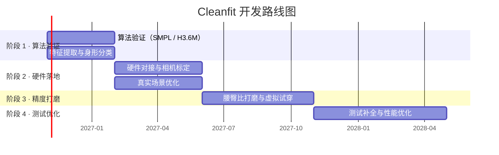

<picture>
  <source media="(prefers-color-scheme: dark)" srcset="assets/hero-dark.svg">
  <source media="(prefers-color-scheme: light)" srcset="assets/hero-light.svg">
  
</picture>

<div align="center">


<br/><br/>

<picture>
  <source media="(prefers-color-scheme: dark)" srcset="assets/pillars-dark.svg">
  <source media="(prefers-color-scheme: light)" srcset="assets/pillars-light.svg">
  
</picture>

</div>


<details open>
<summary>📑 <b>目录</b></summary>
<br/>

- [项目简介](#项目简介)
- [核心功能](#核心功能)
- [实时演示 · Pose Mirror](#实时演示--pose-mirror)
- [系统架构](#系统架构)
- [硬件方案](#硬件方案)
- [精度指标](#精度指标)
- [开发路线图](#开发路线图)
- [项目结构](#项目结构)
- [快速开始](#快速开始)
- [边界说明](#边界说明)
- [参与贡献](#参与贡献)

</details>


## 项目简介

<table>
 <tr>
  <td align="left">

**Cleanfit** 是一款桌面级精准身形测量工具，以消费级深度相机为硬件载体，通过 AI 三维视觉算法精准提取人体比例与身形特征，输出标准化身形分类和版型适配建议，并附带静态虚拟试穿效果验证。

项目走 **「小而准」** 的技术路线 —— 限定场景深耕精度，不做全场景泛化，不堆砌冗余功能。

> 🚧 **项目正在积极开发中。** 功能正在逐步构建和更新，敬请期待！

  </td>
 </tr>
</table>

## 核心功能

<table>
 <tr>
  <td align="center" width="50%" valign="top">
    <br/>
    <h3>🔬 三维比例精准测量</h3>
    <p>深度相机采集人体点云 → AI 提取骨性特征点 → 自动校正透视与距离畸变 → 输出三大核心比例数据。</p>
    <sub><code>头身比</code> <code>肩宽/身高</code> <code>腰臀比</code></sub>
    <br/><br/>
  </td>
  <td align="center" width="50%" valign="top">
    <br/>
    <h3>📊 标准身形分类与版型适配</h3>
    <p>基于比例数据对标行业身形标准，自动分类身形，输出对应上衣 / 下装的版型推荐和雷区版型提示。</p>
    <sub><code>修身</code> <code>合身</code> <code>宽松</code></sub>
    <br/><br/>
  </td>
 </tr>
 <tr>
  <td align="center" width="50%" valign="top">
    <br/>
    <h3>👕 静态虚拟试穿验证</h3>
    <p>上传单件衣服平面图 → 基于测量的身形比例自动形变贴合 → 生成正面试穿效果图，直观验证版型适配效果。</p>
    <sub>照片级静态效果，非实时 AR</sub>
    <br/><br/>
  </td>
  <td align="center" width="50%" valign="top">
    <br/>
    <h3>📋 结构化报告导出</h3>
    <p>输出比例数据、身形分类、版型适配建议的图文报告，可保存、可分享、可对比。</p>
    <sub>PDF / 图片</sub>
    <br/><br/>
  </td>
 </tr>
</table>

## 实时演示 · Pose Mirror

浏览器端可跑的姿态镜像原型：左侧取景窗口接入摄像头，右侧实时重建一具 3D 全息人像，
把画面里人的动作一比一复刻过去，并在取景画面上叠加肩线 / 腰线 / 胯线的测量标注。

```bash
python demo/serve.py
# 打开 http://127.0.0.1:8848/        （摄像头需要 localhost 或 https）
# 打开 http://127.0.0.1:8848/?demo=1 （无摄像头，看合成姿态演示）
```

| 环节 | 方案 |
|:---|:---|
| 姿态估计 | MediaPipe BlazePose，33 关键点，输出以米为单位的世界坐标 |
| 3D 重建 | Three.js 按关键点摆位，关节球 + 骨骼柱 + 躯干面片，指数平滑去抖 |
| 测量 | 人像分割掩码逐行扫描外轮廓，肩 / 腰 / 胯取宽度极值，身高定标换算成厘米 |
| 依赖 | 全部本地化（`demo/vendor/`），无外链、无 CDN，可离线运行 |

这是**视觉与交互的原型验证**，不是最终算法：它用单目 RGB 做估计，精度达不到项目指标，
作用是先把「取景 → 追踪 → 3D 复刻 → 数据面板」这条链路的交互语言定下来。
正式管线仍然走深度相机 + 点云，见下方「系统架构」。

## 系统架构

<picture>
  <source media="(prefers-color-scheme: dark)" srcset="assets/arch-dark.svg">
  <source media="(prefers-color-scheme: light)" srcset="assets/arch-light.svg">
  
</picture>

<table>
 <tr>
  <th align="left" width="24%">模块</th>
  <th align="left">做什么</th>
  <th align="left" width="30%">关键点</th>
 </tr>
 <tr>
  <td><b>① 点云分割与去噪</b></td>
  <td>从衣物边缘、头发、地面噪声中分离出干净的人体轮廓</td>
  <td>边缘噪声是最大的误差来源</td>
 </tr>
 <tr>
  <td><b>② 骨性特征点定位</b></td>
  <td>自动定位头顶、肩峰、腰最细处、臀峰、脚底</td>
  <td>只认骨性标志，不认脂肪与衣物</td>
 </tr>
 <tr>
  <td><b>③ 透视与距离校正</b></td>
  <td>结合相机内参与深度信息，修正不同距离、微小俯仰造成的比例畸变</td>
  <td>1.2m 处 ±0.1m 内保持稳定</td>
 </tr>
 <tr>
  <td><b>④ 分类与版型匹配</b></td>
  <td>比例 → 身形 → 版型，每一句建议都能追溯到具体数据</td>
  <td>可解释，不做黑箱推荐</td>
 </tr>
</table>

## 硬件方案

<table>
 <tr>
  <th width="25%" align="center">📷 深度相机</th>
  <th width="25%" align="center">💰 硬件预算</th>
  <th width="25%" align="center">🎯 选型理由</th>
  <th width="25%" align="center">🔗 软硬结合</th>
 </tr>
 <tr>
  <td align="center">奥比中光 Astra Mini Pro<br/><b>开发版</b></td>
  <td align="center">¥850–950<br/><sub>含官方 SDK 与标定板的完整开发套件</sub></td>
  <td align="center">1 米距离深度均方误差 &lt; 1.5mm<br/><sub>稳定实现 ≤5% 误差的最低硬件门槛</sub></td>
  <td align="center">USB 直连电脑<br/><sub>专属镜头畸变校正、深度噪声适配、特征点优化，算法与硬件<b>深度绑定</b></sub></td>
 </tr>
</table>

> 💡 **为什么不用手机摄像头？** 单目 RGB 缺少真实深度，比例只能靠模型"猜"，误差随姿态和光照剧烈波动。深度相机直接给出几何真值，这是 ≤5% 的前提。

## 精度指标

> 📏 所有指标均基于限定测试场景：室内均匀柔光、正面自然站立、紧身打底衣物、拍摄距离 1.2m ± 0.1m

<table>
 <tr>
  <th align="center" width="18%">类型</th>
  <th align="center">指标</th>
  <th align="center" width="26%">误差承诺</th>
 </tr>
 <tr>
  <td align="center">✅ <b>保证项</b></td>
  <td>头身比、肩宽 / 身高比</td>
  <td align="center">相对误差 ≤ <b>5%</b></td>
 </tr>
 <tr>
  <td align="center">📌 <b>参考项</b></td>
  <td>腰臀比</td>
  <td align="center">相对误差 ≤ <b>7%</b></td>
 </tr>
</table>

**输出形式**：身形分类（倒三角 / H 型 / 梨型 / 苹果型）+ 比例观感描述 + 版型适配建议

<picture>
  <source media="(prefers-color-scheme: dark)" srcset="assets/shapes-dark.svg">
  <source media="(prefers-color-scheme: light)" srcset="assets/shapes-light.svg">
  
</picture>

## 开发路线图



| 阶段 | 周期 | 重点 |
|:---:|:---|:---|
| **1** | 第 1–3 月 | 基于 SMPL / Human3.6M 数据集跑通算法；特征提取、比例校正、身形分类 |
| **2** | 第 4–7 月 | 硬件对接；相机标定、畸变校正、真实场景优化、基础界面 |
| **3** | 第 8–12 月 | 功能完善；腰臀比精度打磨、身形分类、虚拟试穿开发 |
| **4** | 第 13–18 月 | 测试补全、性能优化、可选拓展（侧面测量 / 多体位验证） |

## 项目结构

```
Cleanfit/
├── src/cleanfit/              核心代码
│   ├── capture.py             采集层 · 深度帧与彩色帧对齐
│   ├── segment.py             ① 点云分割与去噪
│   ├── landmark.py            ② 骨性特征点定位
│   ├── calibrate.py           ③ 透视与距离校正
│   ├── classify.py            ④ 身形分类与版型匹配
│   ├── tryon.py               静态虚拟试穿
│   ├── report.py              结构化报告导出
│   ├── pipeline.py            四层串联，一次跑完
│   └── __main__.py            命令行入口
├── demo/                      浏览器端姿态镜像原型（详见 demo/README.md）
├── tests/                     测试
├── assets/                    README 图形素材（本地 SVG，零外链）
├── .github/                   Issue / PR 模板
├── pyproject.toml             打包与工具配置
├── requirements.txt           运行时依赖
├── CONTRIBUTING.md            贡献指南
├── LICENSE                    MIT
└── README.md
```

> 🧩 **当前状态**：`segment.py` 已有基线实现（深度阈值 + 形态学开闭 + 连通域，纯 numpy，含单元测试）；其余算法模块只定义了数据结构与函数签名，调用会抛 `NotImplementedError`。这样做的目的是先把四层之间的数据契约固定下来，再逐层填算法。

## 快速开始

```bash
# 克隆仓库
git clone https://github.com/Aholic-12/Cleanfit.git

# 进入项目目录
cd Cleanfit

# 安装（可编辑模式，同时装好依赖）
pip install -e .

# 或者只装依赖
pip install -r requirements.txt
```

> 📷 奥比中光 Astra SDK 不在 PyPI 上，需从官网下载安装。**不装 SDK 也能跑算法层**——只要不进 `capture` 模块，其余部分可以用离线数据开发。

<details>
<summary>📦 <b>环境依赖</b></summary>
<br/>

<table>
 <tr>
  <th align="left">依赖</th>
  <th align="left" width="18%">版本</th>
  <th align="left">用途</th>
 </tr>
 <tr><td>Python</td><td><code>3.9+</code></td><td>运行时</td></tr>
 <tr><td>Open3D</td><td><code>0.17+</code></td><td>点云处理</td></tr>
 <tr><td>奥比中光 Astra SDK</td><td><code>最新版</code></td><td>深度相机接口</td></tr>
 <tr><td>NumPy</td><td><code>最新版</code></td><td>数值计算</td></tr>
 <tr><td>OpenCV</td><td><code>最新版</code></td><td>图像处理与标定</td></tr>
</table>

</details>

<details>
<summary>⚠️ <b>运行前请确认</b></summary>
<br/>

- 相机通过 USB 3.0 直连（避免 USB Hub 降压掉帧）
- 环境为室内均匀柔光，避免顶光直射与逆光
- 穿着紧身打底衣物，赤足站立
- 拍摄距离保持 **1.2m ± 0.1m**，镜头与身体正面平行

</details>

## 边界说明

> ⚠️ 以下是有意为之的设计约束，不是缺陷。

<table>
 <tr>
  <td width="50%" valign="top">
    <br/>
    <b>🚫 不做实时 AR 试穿</b><br/>
    <sub>仅实现静态照片级试穿效果，不涉及布料仿真与动态渲染。</sub>
    <br/><br/>
  </td>
  <td width="50%" valign="top">
    <br/>
    <b>🧠 聚焦 AI 能力</b><br/>
    <sub>核心聚焦三维特征提取与校正，不为堆砌 AI 而滥用模型。</sub>
    <br/><br/>
  </td>
 </tr>
 <tr>
  <td width="50%" valign="top">
    <br/>
    <b>🎯 限定场景精度</b><br/>
    <sub>所有指标均基于受控测试环境，不夸大全场景通用效果。</sub>
    <br/><br/>
  </td>
  <td width="50%" valign="top">
    <br/>
    <b>⚡ 精度优先</b><br/>
    <sub>优先保证核心测量的精度与稳定性，再考虑功能拓展。</sub>
    <br/><br/>
  </td>
 </tr>
</table>

## 参与贡献

欢迎贡献代码！如果你有想法或想一起打造 Cleanfit，完整流程见 **[CONTRIBUTING.md](CONTRIBUTING.md)**。

```
Fork → Branch → Commit → Push → PR
```

1. Fork 本仓库
2. 创建你的功能分支 (`git checkout -b feature/amazing-feature`)
3. 提交你的修改 (`git commit -m 'feat(landmark): 用切片宽度曲线定位肩峰'`)
4. 推送到分支 (`git push origin feature/amazing-feature`)
5. 发起 Pull Request

> 提 PR 前请先跑 `ruff check .` 和 `pytest`。涉及精度改动的，附上改动前后的误差对比数据。


<br/>

<picture>
  <source media="(prefers-color-scheme: dark)" srcset="assets/footer-dark.svg">
  <source media="(prefers-color-scheme: light)" srcset="assets/footer-light.svg">
  
</picture>

<div align="center">

<br/>

<a href="https://github.com/Aholic-12">
  
</a>

<br/><br/>

<i>⭐ 如果你喜欢这个项目，请给个 Star 支持一下！</i>

<br/><br/>

<sub>本 README 的全部图形均为仓库内本地 SVG（含 SMIL 动效），不依赖任何外部图床。</sub>

</div>
