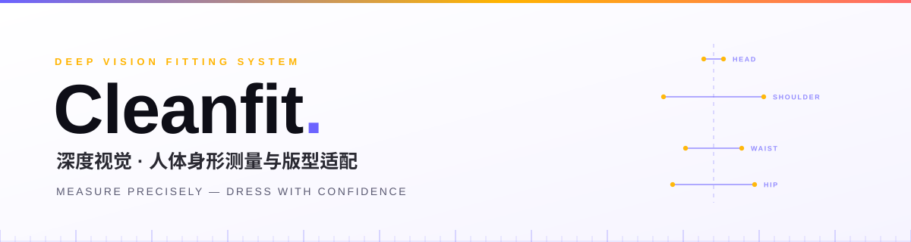
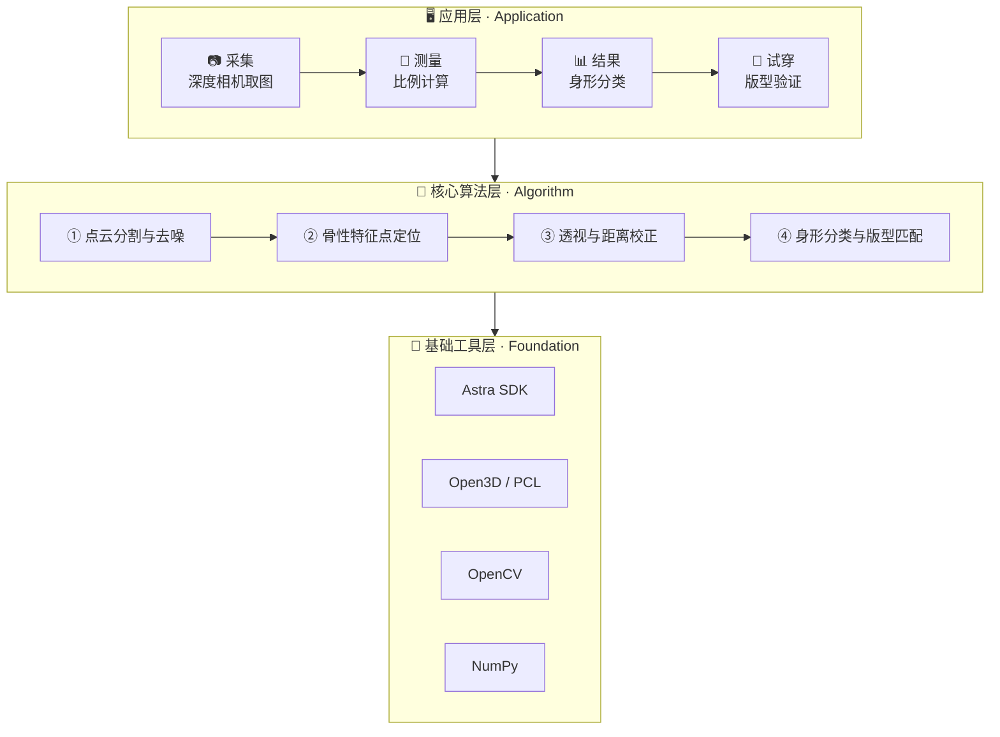
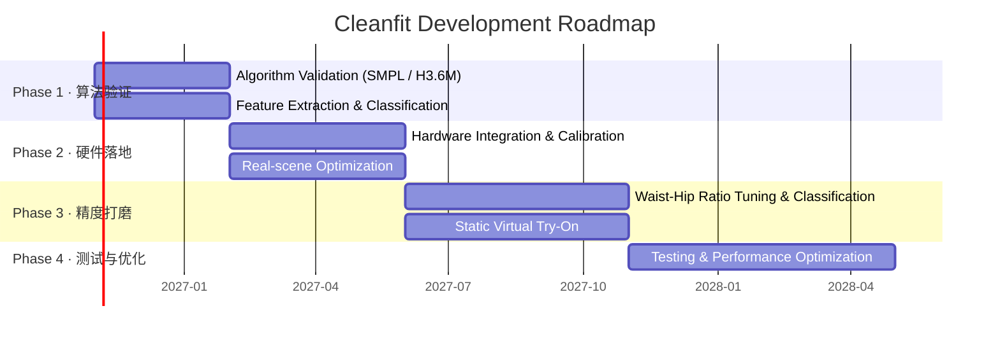

<picture>
  <source media="(prefers-color-scheme: dark)" srcset="assets/header-dark.svg">
  <source media="(prefers-color-scheme: light)" srcset="assets/header-light.svg">
  
</picture>

<div align="center">


<br/><br/>

<b>用一台消费级深度相机，把「我穿什么版型好看」变成一组可测量的数字。</b>

<br/>

<sub>身体比例 → 身形分类 → 版型建议，18 个月做到 ≤5% 误差。</sub>

<br/><br/>

<a href="#-为什么需要-cleanfit"><kbd>为什么</kbd></a>
<a href="#-核心功能"><kbd>核心功能</kbd></a>
<a href="#-系统架构"><kbd>系统架构</kbd></a>
<a href="#-硬件方案"><kbd>硬件方案</kbd></a>
<a href="#-精度指标"><kbd>精度指标</kbd></a>
<a href="#-开发路线图"><kbd>路线图</kbd></a>
<a href="#-快速开始"><kbd>快速开始</kbd></a>
<a href="#english-summary"><kbd>English</kbd></a>

</div>


## 🎯 为什么需要 Cleanfit

<div align="center">

<table width="100%">
 <tr>
  <td align="center" width="33%" valign="top">
    <h3>😵‍💫</h3>
    <b>尺码表靠不住</b><br/>
    <sub>同一个 M 码，<br/>不同品牌差出两个号。<br/>线上买衣服像抽盲盒。</sub>
  </td>
  <td align="center" width="33%" valign="top">
    <h3>🪞</h3>
    <b>镜子不会说谎，但也不解释</b><br/>
    <sub>你知道自己"肩宽"，<br/>但不知道肩宽 / 身高 = 0.26<br/>意味着什么版型。</sub>
  </td>
  <td align="center" width="33%" valign="top">
    <h3>📐</h3>
    <b>量体成本太高</b><br/>
    <sub>裁缝量体几十项数据、<br/>要预约、要上门。<br/>而穿搭只需要 3 个比例。</sub>
  </td>
 </tr>
</table>

</div>

**Cleanfit 只做一件事**：在受控场景下，把 3 个关键比例测准（≤5% 误差），翻译成一句人话——**"你适合什么版型，避开什么版型"**。


## ✨ 核心功能

<div align="center">

<table width="100%">
 <tr>
  <td align="center" width="50%" valign="top">
    <br/>
    <h3>🔬 三维比例精准测量</h3>
    <p>深度相机采集人体点云 → AI 提取骨性特征点 → 自动校正透视与距离畸变 → 输出三大核心比例。</p>
    <sub><code>头身比</code> <code>肩宽/身高</code> <code>腰臀比</code></sub>
    <br/><br/>
  </td>
  <td align="center" width="50%" valign="top">
    <br/>
    <h3>📊 身形分类与版型适配</h3>
    <p>比例数据对标行业身形标准自动分类，输出上衣 / 下装的版型推荐，并给出「雷区版型」提示。</p>
    <sub><code>修身</code> <code>合身</code> <code>宽松</code></sub>
    <br/><br/>
  </td>
 </tr>
 <tr>
  <td align="center" width="50%" valign="top">
    <br/>
    <h3>👕 静态虚拟试穿验证</h3>
    <p>上传单件衣服平面图 → 基于实测身形比例自动形变贴合 → 生成正面试穿效果图，直观验证版型。</p>
    <sub>照片级静态效果，非实时 AR</sub>
    <br/><br/>
  </td>
  <td align="center" width="50%" valign="top">
    <br/>
    <h3>📋 结构化报告导出</h3>
    <p>比例数据、身形分类、版型建议一次性导出为图文报告，可保存、可分享、可对比。</p>
    <sub>PDF / 图片</sub>
    <br/><br/>
  </td>
 </tr>
</table>

</div>


## 🧠 系统架构



<table width="100%">
 <tr>
  <th align="left" width="22%">模块</th>
  <th align="left">做什么</th>
  <th align="left" width="34%">关键点</th>
 </tr>
 <tr>
  <td><b>① 点云分割与去噪</b></td>
  <td>从衣物边缘、头发、地面噪声中分离出干净的人体轮廓</td>
  <td>边缘噪声是最大的误差来源</td>
 </tr>
 <tr>
  <td><b>② 骨性特征点定位</b></td>
  <td>自动定位头顶、肩峰、腰最细处、臀峰、脚底</td>
  <td>只认骨性标志，不认脂肪与衣物</td>
 </tr>
 <tr>
  <td><b>③ 透视与距离校正</b></td>
  <td>结合相机内参与深度信息，修正不同距离、微小俯仰造成的比例畸变</td>
  <td>1.2m 处 ±0.1m 内保持稳定</td>
 </tr>
 <tr>
  <td><b>④ 分类与版型匹配</b></td>
  <td>比例 → 身形 → 版型，每一句建议都能追溯到具体数据</td>
  <td>可解释，不做黑箱推荐</td>
 </tr>
</table>


## 📷 硬件方案

<div align="center">

<table width="100%">
 <tr>
  <th width="25%" align="center">深度相机</th>
  <th width="25%" align="center">硬件预算</th>
  <th width="25%" align="center">选型理由</th>
  <th width="25%" align="center">软硬结合</th>
 </tr>
 <tr>
  <td align="center">
    <b>奥比中光 Astra Mini Pro</b><br/>
    <sub>开发版</sub>
  </td>
  <td align="center">
    <b>¥850–950</b><br/>
    <sub>含官方 SDK 与标定板<br/>的完整开发套件</sub>
  </td>
  <td align="center">
    <b>1m 处深度 MSE &lt; 1.5mm</b><br/>
    <sub>稳定实现 ≤5% 误差的<br/>最低硬件门槛</sub>
  </td>
  <td align="center">
    <b>USB 直连电脑</b><br/>
    <sub>镜头畸变校正、深度噪声适配、<br/>特征点优化，<br/>算法与硬件深度绑定</sub>
  </td>
 </tr>
</table>

</div>

> 💡 **为什么不用手机摄像头？** 单目 RGB 缺少真实深度，只能靠模型"猜"比例，误差随姿态和光照剧烈波动。深度相机直接给出几何真值，这是 ≤5% 的前提。


## 📏 精度指标

<sub>所有指标基于限定测试场景：室内均匀柔光 · 正面自然站立 · 紧身打底衣物 · 拍摄距离 1.2m ± 0.1m</sub>

<table width="100%">
 <tr>
  <th align="center" width="18%">类型</th>
  <th align="center">指标</th>
  <th align="center" width="26%">误差承诺</th>
 </tr>
 <tr>
  <td align="center">✅ <b>保证项</b></td>
  <td>头身比 · 肩宽 / 身高比</td>
  <td align="center">相对误差 ≤ <b>5%</b></td>
 </tr>
 <tr>
  <td align="center">📌 <b>参考项</b></td>
  <td>腰臀比</td>
  <td align="center">相对误差 ≤ <b>7%</b></td>
 </tr>
</table>

**输出形式**：身形分类（倒三角 / H 型 / 梨型 / 苹果型）+ 比例观感描述 + 版型适配建议

<table width="100%">
 <tr>
  <td align="center" width="25%">🔻<br/><b>倒三角</b><br/><sub>肩宽 &gt; 胯宽</sub></td>
  <td align="center" width="25%">🔲<br/><b>H 型</b><br/><sub>肩胯接近</sub></td>
  <td align="center" width="25%">🍐<br/><b>梨型</b><br/><sub>胯宽 &gt; 肩宽</sub></td>
  <td align="center" width="25%">🍎<br/><b>苹果型</b><br/><sub>腰腹突出</sub></td>
 </tr>
</table>


## 🗺️ 开发路线图

<div align="center">

<sub><code>▰▰▰▱▱▱▱▱▱▱▱▱▱▱▱▱▱▱</code> 阶段 1 · 进行中</sub>

</div>



<table width="100%">
 <tr>
  <th align="center" width="10%">阶段</th>
  <th align="center" width="18%">周期</th>
  <th align="left">重点</th>
 </tr>
 <tr>
  <td align="center"><b>1</b></td>
  <td align="center">第 1–3 月</td>
  <td>基于 SMPL / Human3.6M 跑通算法；特征提取、比例校正、身形分类</td>
 </tr>
 <tr>
  <td align="center"><b>2</b></td>
  <td align="center">第 4–7 月</td>
  <td>硬件对接；相机标定、畸变校正、真实场景优化、基础界面</td>
 </tr>
 <tr>
  <td align="center"><b>3</b></td>
  <td align="center">第 8–12 月</td>
  <td>腰臀比精度打磨、身形分类完善、虚拟试穿开发</td>
 </tr>
 <tr>
  <td align="center"><b>4</b></td>
  <td align="center">第 13–18 月</td>
  <td>测试补全、性能优化、可选拓展（侧面测量 / 多体位验证）</td>
 </tr>
</table>


## 🚀 快速开始

```bash
# 1. 克隆仓库
git clone https://github.com/Aholic-12/Cleanfit.git
cd Cleanfit

# 2. 安装依赖
pip install -r requirements.txt

# 3. 运行（详细文档随开发进度更新）
python main.py
```

<details>
<summary>📦 <b>环境依赖</b></summary>
<br/>

<table width="100%">
 <tr>
  <th align="left">依赖</th>
  <th align="left" width="18%">版本</th>
  <th align="left">用途</th>
 </tr>
 <tr>
  <td>Python</td>
  <td><code>3.8+</code></td>
  <td>运行时</td>
 </tr>
 <tr>
  <td>Open3D</td>
  <td><code>0.17+</code></td>
  <td>点云处理</td>
 </tr>
 <tr>
  <td>奥比中光 Astra SDK</td>
  <td><code>最新版</code></td>
  <td>深度相机接口</td>
 </tr>
 <tr>
  <td>NumPy</td>
  <td><code>最新版</code></td>
  <td>数值计算</td>
 </tr>
 <tr>
  <td>OpenCV</td>
  <td><code>最新版</code></td>
  <td>图像处理与标定</td>
 </tr>
</table>

</details>

<details>
<summary>⚠️ <b>运行前请确认</b></summary>
<br/>

- 相机已通过 USB 3.0 直连（避免 USB Hub 降压导致掉帧）
- 环境为室内均匀柔光，避免顶光直射与逆光
- 穿着紧身打底衣物，赤足站立
- 拍摄距离保持在 **1.2m ± 0.1m**，镜头与身体正面平行

</details>


## 🧭 边界说明

> ⚠️ 以下是有意为之的设计约束，不是缺陷。

<table width="100%">
 <tr>
  <td width="50%" valign="top">
    <br/>
    <b>🚫 不做实时 AR 试穿</b><br/>
    <sub>仅实现静态照片级试穿，不涉及布料仿真与动态渲染。</sub>
    <br/><br/>
  </td>
  <td width="50%" valign="top">
    <br/>
    <b>🧠 不堆模型</b><br/>
    <sub>核心聚焦三维特征提取与校正，不为堆砌 AI 而滥用模型。</sub>
    <br/><br/>
  </td>
 </tr>
 <tr>
  <td width="50%" valign="top">
    <br/>
    <b>🎯 限定场景精度</b><br/>
    <sub>所有指标基于受控环境，不夸大全场景通用效果。</sub>
    <br/><br/>
  </td>
  <td width="50%" valign="top">
    <br/>
    <b>⚡ 精度优先于功能</b><br/>
    <sub>先保证核心测量的稳定性，再谈功能拓展。</sub>
    <br/><br/>
  </td>
 </tr>
</table>


## 🤝 参与贡献

欢迎贡献代码、数据或想法！无论是算法优化、场景测试还是文档改进，都非常需要。

```
Fork → Branch → Commit → Push → PR
```

1. Fork 本仓库
2. 创建功能分支：`git checkout -b feature/amazing-feature`
3. 提交修改：`git commit -m 'Add some amazing feature'`
4. 推送分支：`git push origin feature/amazing-feature`
5. 发起 Pull Request


## English Summary

**Cleanfit** is a desktop-grade body measurement and fit-adaptation system. A consumer depth camera (Orbbec Astra Mini Pro) captures a human point cloud; AI 3D-vision algorithms extract skeletal landmarks, correct perspective and distance distortion, and output three core body ratios — then translate them into a standardized body-shape classification and concrete garment-fit recommendations, with a static virtual try-on for visual verification.

| | |
|:---|:---|
| **Guaranteed accuracy** | Head-to-body ratio, shoulder-width / height ratio — ≤ **5%** relative error |
| **Reference accuracy** | Waist-to-hip ratio — ≤ **7%** relative error |
| **Output** | Body shape (Inverted Triangle / H / Pear / Apple) + proportion description + fit recommendations |
| **Stack** | Python 3.8+ · Open3D · OpenCV · NumPy · Orbbec Astra SDK |
| **Scope** | Controlled indoor scene, frontal standing, form-fitting base layer, 1.2m ± 0.1m |
Design philosophy: **small but precise** — deep specialization in one scenario with rigorous accuracy, no over-generalization, no feature bloat. No real-time AR try-on, no unnecessary model stacking.

<br/>

<picture>
  <source media="(prefers-color-scheme: dark)" srcset="assets/footer-dark.svg">
  <source media="(prefers-color-scheme: light)" srcset="assets/footer-light.svg">
  
</picture>

<div align="center">

<br/>

<a href="https://github.com/Aholic-12">
  
</a>

<br/><br/>

<i>⭐ 如果这个项目对你有用，给个 Star 支持一下！</i>

<br/>

<sub>本项目 README 的图片均为仓库内本地 SVG，不依赖任何外部图床。</sub>

</div>
