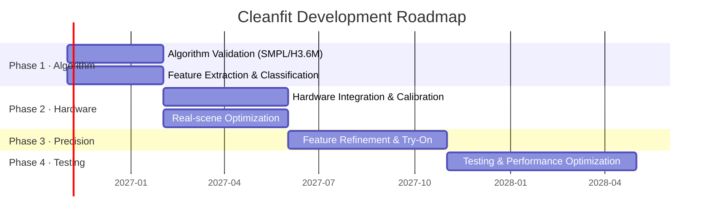
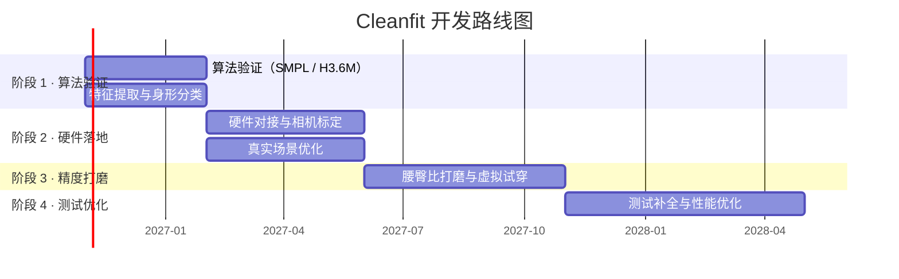

<picture>
  <source media="(prefers-color-scheme: dark)" srcset="assets/hero-dark.svg">
  <source media="(prefers-color-scheme: light)" srcset="assets/hero-light.svg">
  
</picture>

<div align="center">


<br/><br/>

<picture>
  <source media="(prefers-color-scheme: dark)" srcset="assets/pillars-dark.svg">
  <source media="(prefers-color-scheme: light)" srcset="assets/pillars-light.svg">
  
</picture>

<br/>

<a href="#-english"></a>
&nbsp;
<a href="#-中文"></a>

</div>


<details open>
<summary>📑 <b>Table of Contents / 目录</b></summary>
<br/>

<table width="100%">
 <tr>
  <td width="50%" valign="top">

**English**
- [About](#about)
- [Core Features](#core-features)
- [System Architecture](#system-architecture)
- [Hardware](#hardware)
- [Accuracy Specifications](#accuracy-specifications)
- [Roadmap](#roadmap)
- [Getting Started](#getting-started)
- [Design Boundaries](#design-boundaries)
- [Contributing](#contributing)

  </td>
  <td width="50%" valign="top">

**中文**
- [项目简介](#项目简介)
- [核心功能](#核心功能)
- [系统架构](#系统架构)
- [硬件方案](#硬件方案)
- [精度指标](#精度指标)
- [开发路线图](#开发路线图)
- [快速开始](#快速开始)
- [边界说明](#边界说明)
- [参与贡献](#参与贡献)

  </td>
 </tr>
</table>

</details>


## 🌟 English

### About

<table width="100%">
 <tr>
  <td align="left">

**Cleanfit** is a desktop-grade body measurement and fit adaptation system powered by a consumer-level depth camera and AI 3D vision algorithms. It precisely extracts body proportions and shape features, outputs standardized body shape classifications and clothing fit recommendations, and includes static virtual try-on for visual verification.

The project follows a **"small but precise"** technical philosophy — deep specialization in targeted scenarios with rigorous accuracy, without over-generalization or feature bloat.

> 🚧 **This project is currently under active development.** Features are being built and updated regularly. Stay tuned!

  </td>
 </tr>
</table>

### Core Features

<table width="100%">
 <tr>
  <td align="center" width="50%" valign="top">
    <br/>
    <h3>🔬 3D Proportional Measurement</h3>
    <p>Depth camera captures human point cloud → AI extracts skeletal feature points → auto-corrects perspective &amp; distance distortion → outputs three core proportional measurements.</p>
    <sub><code>head-to-body</code> <code>shoulder / height</code> <code>waist / hip</code></sub>
    <br/><br/>
  </td>
  <td align="center" width="50%" valign="top">
    <br/>
    <h3>📊 Body Shape Classification</h3>
    <p>Benchmarks ratio data against industry standards for automatic classification. Outputs fit recommendations (slim / regular / relaxed) per garment with "avoid" warnings.</p>
    <sub><code>slim</code> <code>regular</code> <code>relaxed</code></sub>
    <br/><br/>
  </td>
 </tr>
 <tr>
  <td align="center" width="50%" valign="top">
    <br/>
    <h3>👕 Static Virtual Try-On</h3>
    <p>Upload a flat garment image → system warps and fits it onto your measured body proportions → generates a frontal try-on preview for visual fit verification.</p>
    <sub>Photo-level static result, not real-time AR</sub>
    <br/><br/>
  </td>
  <td align="center" width="50%" valign="top">
    <br/>
    <h3>📋 Report Export</h3>
    <p>Outputs proportional data, body shape classification, and fit adaptation recommendations as structured visual reports.</p>
    <sub>PDF / image</sub>
    <br/><br/>
  </td>
 </tr>
</table>

### System Architecture

<picture>
  <source media="(prefers-color-scheme: dark)" srcset="assets/arch-dark.svg">
  <source media="(prefers-color-scheme: light)" srcset="assets/arch-light.svg">
  
</picture>

<table width="100%">
 <tr>
  <th align="left" width="24%">Module</th>
  <th align="left">What it does</th>
  <th align="left" width="30%">Key point</th>
 </tr>
 <tr>
  <td><b>① Segmentation &amp; Denoising</b></td>
  <td>Separates a clean body contour from clothing edges, hair and floor noise</td>
  <td>Edge noise is the dominant error source</td>
 </tr>
 <tr>
  <td><b>② Feature Localization</b></td>
  <td>Auto-locates head top, acromion, narrowest waist, hip peak, foot sole</td>
  <td>Anchors on bone, not on fat or fabric</td>
 </tr>
 <tr>
  <td><b>③ Perspective Correction</b></td>
  <td>Camera intrinsics + depth to remove ratio distortion across distance and slight pitch</td>
  <td>Stable within ±0.1m at 1.2m</td>
 </tr>
 <tr>
  <td><b>④ Classification &amp; Fit</b></td>
  <td>Ratio → body shape → garment fit, every recommendation traceable to data</td>
  <td>Explainable, never a black box</td>
 </tr>
</table>

### Hardware

<table width="100%">
 <tr>
  <th width="25%" align="center">📷 Camera</th>
  <th width="25%" align="center">💰 Budget</th>
  <th width="25%" align="center">🎯 Why This One</th>
  <th width="25%" align="center">🔗 Integration</th>
 </tr>
 <tr>
  <td align="center">Orbbec Astra Mini Pro<br/><b>Developer Edition</b></td>
  <td align="center">¥850–950<br/><sub>full dev kit with SDK<br/>&amp; calibration board</sub></td>
  <td align="center">Depth MSE &lt; 1.5mm at 1m<br/><sub>minimum threshold for<br/>stable ≤5% error</sub></td>
  <td align="center">USB direct-connect<br/><sub>distortion correction, noise<br/>adaptation &amp; feature<br/>optimization <b>tightly coupled</b></sub></td>
 </tr>
</table>

> 💡 **Why not a phone camera?** A single RGB frame has no true depth, so proportions must be *guessed* by a model — error swings with pose and lighting. A depth camera gives geometric ground truth, which is the precondition for ≤5%.

### Accuracy Specifications

> 📏 All specs under controlled conditions: indoor soft lighting, frontal standing, form-fitting base layer, 1.2m ± 0.1m distance.

<table width="100%">
 <tr>
  <th align="center" width="18%">Type</th>
  <th align="center">Metric</th>
  <th align="center" width="26%">Error Bound</th>
 </tr>
 <tr>
  <td align="center">✅ <b>Guaranteed</b></td>
  <td>Head-to-body ratio, Shoulder-width / Height ratio</td>
  <td align="center">≤ <b>5%</b> relative error</td>
 </tr>
 <tr>
  <td align="center">📌 <b>Reference</b></td>
  <td>Waist-to-hip ratio</td>
  <td align="center">≤ <b>7%</b> relative error</td>
 </tr>
</table>

**Output**: Body shape classification (Inverted Triangle / H-shape / Pear / Apple) + proportional description + fit adaptation recommendations.

<picture>
  <source media="(prefers-color-scheme: dark)" srcset="assets/shapes-dark.svg">
  <source media="(prefers-color-scheme: light)" srcset="assets/shapes-light.svg">
  
</picture>

### Roadmap



| Phase | Period | Focus |
|:---:|:---|:---|
| **1** | Month 1–3 | Algorithm validation on SMPL / Human3.6M datasets; feature extraction, ratio correction, body classification |
| **2** | Month 4–7 | Hardware integration; camera calibration, real-scene optimization, basic UI flow |
| **3** | Month 8–12 | Feature refinement; waist-hip ratio tuning, body classification, virtual try-on |
| **4** | Month 13–18 | Testing expansion, performance optimization, optional side-view & multi-pose |

### Getting Started

```bash
# Clone the repository
git clone https://github.com/Aholic-12/Cleanfit.git

# Navigate to the project directory
cd Cleanfit

# Install dependencies (detailed instructions coming soon)
pip install -r requirements.txt
```

<details>
<summary>📦 <b>Environment Requirements</b></summary>
<br/>

<table width="100%">
 <tr>
  <th align="left">Dependency</th>
  <th align="left" width="18%">Version</th>
  <th align="left">Purpose</th>
 </tr>
 <tr><td>Python</td><td><code>3.8+</code></td><td>Runtime</td></tr>
 <tr><td>Open3D</td><td><code>0.17+</code></td><td>Point cloud processing</td></tr>
 <tr><td>Orbbec Astra SDK</td><td><code>Latest</code></td><td>Depth camera interface</td></tr>
 <tr><td>NumPy</td><td><code>Latest</code></td><td>Numerical computation</td></tr>
 <tr><td>OpenCV</td><td><code>Latest</code></td><td>Image processing &amp; calibration</td></tr>
</table>

</details>

### Design Boundaries

> ⚠️ These are intentional constraints, not limitations.

<table width="100%">
 <tr>
  <td width="50%" valign="top">
    <br/>
    <b>🚫 No real-time AR try-on</b><br/>
    <sub>Static photo-level only; no cloth simulation or dynamic rendering.</sub>
    <br/><br/>
  </td>
  <td width="50%" valign="top">
    <br/>
    <b>🧠 Focused AI</b><br/>
    <sub>3D feature extraction &amp; correction only; no unnecessary model stacking.</sub>
    <br/><br/>
  </td>
 </tr>
 <tr>
  <td width="50%" valign="top">
    <br/>
    <b>🎯 Scene-limited accuracy</b><br/>
    <sub>All specs apply under controlled conditions; no over-claiming.</sub>
    <br/><br/>
  </td>
  <td width="50%" valign="top">
    <br/>
    <b>⚡ Precision first</b><br/>
    <sub>Core measurement stability takes priority over feature expansion.</sub>
    <br/><br/>
  </td>
 </tr>
</table>

### Contributing

Contributions are welcome! If you have ideas or want to help build Cleanfit together:

```
Fork → Branch → Commit → Push → PR
```

1. Fork the repository
2. Create your feature branch (`git checkout -b feature/amazing-feature`)
3. Commit your changes (`git commit -m 'Add some amazing feature'`)
4. Push to the branch (`git push origin feature/amazing-feature`)
5. Open a Pull Request


## 🇨🇳 中文

### 项目简介

<table width="100%">
 <tr>
  <td align="left">

**Cleanfit** 是一款桌面级精准身形测量工具，以消费级深度相机为硬件载体，通过 AI 三维视觉算法精准提取人体比例与身形特征，输出标准化身形分类和版型适配建议，并附带静态虚拟试穿效果验证。

项目走 **「小而准」** 的技术路线 —— 限定场景深耕精度，不做全场景泛化，不堆砌冗余功能。

> 🚧 **项目正在积极开发中。** 功能正在逐步构建和更新，敬请期待！

  </td>
 </tr>
</table>

### 核心功能

<table width="100%">
 <tr>
  <td align="center" width="50%" valign="top">
    <br/>
    <h3>🔬 三维比例精准测量</h3>
    <p>深度相机采集人体点云 → AI 提取骨性特征点 → 自动校正透视与距离畸变 → 输出三大核心比例数据。</p>
    <sub><code>头身比</code> <code>肩宽/身高</code> <code>腰臀比</code></sub>
    <br/><br/>
  </td>
  <td align="center" width="50%" valign="top">
    <br/>
    <h3>📊 标准身形分类与版型适配</h3>
    <p>基于比例数据对标行业身形标准，自动分类身形，输出对应上衣 / 下装的版型推荐和雷区版型提示。</p>
    <sub><code>修身</code> <code>合身</code> <code>宽松</code></sub>
    <br/><br/>
  </td>
 </tr>
 <tr>
  <td align="center" width="50%" valign="top">
    <br/>
    <h3>👕 静态虚拟试穿验证</h3>
    <p>上传单件衣服平面图 → 基于测量的身形比例自动形变贴合 → 生成正面试穿效果图，直观验证版型适配效果。</p>
    <sub>照片级静态效果，非实时 AR</sub>
    <br/><br/>
  </td>
  <td align="center" width="50%" valign="top">
    <br/>
    <h3>📋 结构化报告导出</h3>
    <p>输出比例数据、身形分类、版型适配建议的图文报告，可保存、可分享、可对比。</p>
    <sub>PDF / 图片</sub>
    <br/><br/>
  </td>
 </tr>
</table>

### 系统架构

<picture>
  <source media="(prefers-color-scheme: dark)" srcset="assets/arch-dark.svg">
  <source media="(prefers-color-scheme: light)" srcset="assets/arch-light.svg">
  
</picture>

<table width="100%">
 <tr>
  <th align="left" width="24%">模块</th>
  <th align="left">做什么</th>
  <th align="left" width="30%">关键点</th>
 </tr>
 <tr>
  <td><b>① 点云分割与去噪</b></td>
  <td>从衣物边缘、头发、地面噪声中分离出干净的人体轮廓</td>
  <td>边缘噪声是最大的误差来源</td>
 </tr>
 <tr>
  <td><b>② 骨性特征点定位</b></td>
  <td>自动定位头顶、肩峰、腰最细处、臀峰、脚底</td>
  <td>只认骨性标志，不认脂肪与衣物</td>
 </tr>
 <tr>
  <td><b>③ 透视与距离校正</b></td>
  <td>结合相机内参与深度信息，修正不同距离、微小俯仰造成的比例畸变</td>
  <td>1.2m 处 ±0.1m 内保持稳定</td>
 </tr>
 <tr>
  <td><b>④ 分类与版型匹配</b></td>
  <td>比例 → 身形 → 版型，每一句建议都能追溯到具体数据</td>
  <td>可解释，不做黑箱推荐</td>
 </tr>
</table>

### 硬件方案

<table width="100%">
 <tr>
  <th width="25%" align="center">📷 深度相机</th>
  <th width="25%" align="center">💰 硬件预算</th>
  <th width="25%" align="center">🎯 选型理由</th>
  <th width="25%" align="center">🔗 软硬结合</th>
 </tr>
 <tr>
  <td align="center">奥比中光 Astra Mini Pro<br/><b>开发版</b></td>
  <td align="center">¥850–950<br/><sub>含官方 SDK 与标定板<br/>的完整开发套件</sub></td>
  <td align="center">1 米距离深度均方误差<br/>&lt; 1.5mm<br/><sub>稳定实现 ≤5% 误差的<br/>最低硬件门槛</sub></td>
  <td align="center">USB 直连电脑<br/><sub>专属镜头畸变校正、<br/>深度噪声适配、<br/>特征点优化，<br/>算法与硬件<b>深度绑定</b></sub></td>
 </tr>
</table>

> 💡 **为什么不用手机摄像头？** 单目 RGB 缺少真实深度，比例只能靠模型"猜"，误差随姿态和光照剧烈波动。深度相机直接给出几何真值，这是 ≤5% 的前提。

### 精度指标

> 📏 所有指标均基于限定测试场景：室内均匀柔光、正面自然站立、紧身打底衣物、拍摄距离 1.2m ± 0.1m

<table width="100%">
 <tr>
  <th align="center" width="18%">类型</th>
  <th align="center">指标</th>
  <th align="center" width="26%">误差承诺</th>
 </tr>
 <tr>
  <td align="center">✅ <b>保证项</b></td>
  <td>头身比、肩宽 / 身高比</td>
  <td align="center">相对误差 ≤ <b>5%</b></td>
 </tr>
 <tr>
  <td align="center">📌 <b>参考项</b></td>
  <td>腰臀比</td>
  <td align="center">相对误差 ≤ <b>7%</b></td>
 </tr>
</table>

**输出形式**：身形分类（倒三角 / H 型 / 梨型 / 苹果型）+ 比例观感描述 + 版型适配建议

<picture>
  <source media="(prefers-color-scheme: dark)" srcset="assets/shapes-dark.svg">
  <source media="(prefers-color-scheme: light)" srcset="assets/shapes-light.svg">
  
</picture>

### 开发路线图



| 阶段 | 周期 | 重点 |
|:---:|:---|:---|
| **1** | 第 1–3 月 | 基于 SMPL / Human3.6M 数据集跑通算法；特征提取、比例校正、身形分类 |
| **2** | 第 4–7 月 | 硬件对接；相机标定、畸变校正、真实场景优化、基础界面 |
| **3** | 第 8–12 月 | 功能完善；腰臀比精度打磨、身形分类、虚拟试穿开发 |
| **4** | 第 13–18 月 | 测试补全、性能优化、可选拓展（侧面测量 / 多体位验证） |

### 快速开始

```bash
# 克隆仓库
git clone https://github.com/Aholic-12/Cleanfit.git

# 进入项目目录
cd Cleanfit

# 安装依赖（详细文档随开发进度更新）
pip install -r requirements.txt
```

<details>
<summary>📦 <b>环境依赖</b></summary>
<br/>

<table width="100%">
 <tr>
  <th align="left">依赖</th>
  <th align="left" width="18%">版本</th>
  <th align="left">用途</th>
 </tr>
 <tr><td>Python</td><td><code>3.8+</code></td><td>运行时</td></tr>
 <tr><td>Open3D</td><td><code>0.17+</code></td><td>点云处理</td></tr>
 <tr><td>奥比中光 Astra SDK</td><td><code>最新版</code></td><td>深度相机接口</td></tr>
 <tr><td>NumPy</td><td><code>最新版</code></td><td>数值计算</td></tr>
 <tr><td>OpenCV</td><td><code>最新版</code></td><td>图像处理与标定</td></tr>
</table>

</details>

<details>
<summary>⚠️ <b>运行前请确认</b></summary>
<br/>

- 相机通过 USB 3.0 直连（避免 USB Hub 降压掉帧）
- 环境为室内均匀柔光，避免顶光直射与逆光
- 穿着紧身打底衣物，赤足站立
- 拍摄距离保持 **1.2m ± 0.1m**，镜头与身体正面平行

</details>

### 边界说明

> ⚠️ 以下是有意为之的设计约束，不是缺陷。

<table width="100%">
 <tr>
  <td width="50%" valign="top">
    <br/>
    <b>🚫 不做实时 AR 试穿</b><br/>
    <sub>仅实现静态照片级试穿效果，不涉及布料仿真与动态渲染。</sub>
    <br/><br/>
  </td>
  <td width="50%" valign="top">
    <br/>
    <b>🧠 聚焦 AI 能力</b><br/>
    <sub>核心聚焦三维特征提取与校正，不为堆砌 AI 而滥用模型。</sub>
    <br/><br/>
  </td>
 </tr>
 <tr>
  <td width="50%" valign="top">
    <br/>
    <b>🎯 限定场景精度</b><br/>
    <sub>所有指标均基于受控测试环境，不夸大全场景通用效果。</sub>
    <br/><br/>
  </td>
  <td width="50%" valign="top">
    <br/>
    <b>⚡ 精度优先</b><br/>
    <sub>优先保证核心测量的精度与稳定性，再考虑功能拓展。</sub>
    <br/><br/>
  </td>
 </tr>
</table>

### 参与贡献

欢迎贡献代码！如果你有想法或想一起打造 Cleanfit：

```
Fork → Branch → Commit → Push → PR
```

1. Fork 本仓库
2. 创建你的功能分支 (`git checkout -b feature/amazing-feature`)
3. 提交你的修改 (`git commit -m 'Add some amazing feature'`)
4. 推送到分支 (`git push origin feature/amazing-feature`)
5. 发起 Pull Request


<br/>

<picture>
  <source media="(prefers-color-scheme: dark)" srcset="assets/footer-dark.svg">
  <source media="(prefers-color-scheme: light)" srcset="assets/footer-light.svg">
  
</picture>

<div align="center">

<br/>

<a href="https://github.com/Aholic-12">
  
</a>

<br/><br/>

<i>⭐ If you like this project, give it a star!</i>
<br/>
<i>如果你喜欢这个项目，请给个 Star 支持一下！</i>

<br/><br/>

<sub>本 README 的全部图形均为仓库内本地 SVG（含 SMIL 动效），不依赖任何外部图床。</sub>

</div>
