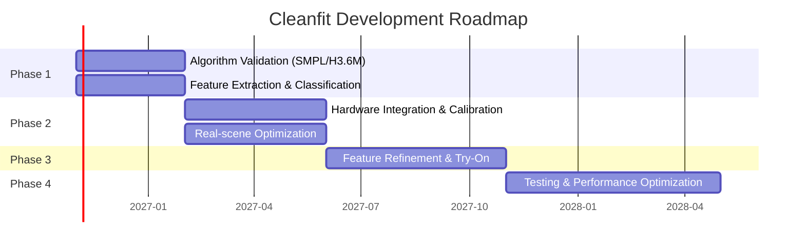

<div align="center">

# 🧵 Cleanfit

### *Deep Vision Body Measurement & Fit Adaptation*
### *基于深度视觉的人体身形测量与版型适配系统*

<br/>

<p>
  
  
  
  
  
</p>

<br/>

<table border="0">
 <tr>
  <td align="center" width="25%">
    <h3>🎯</h3>
    <b>≤5% Error</b><br/>
    <sub>精准测量</sub>
  </td>
  <td align="center" width="25%">
    <h3>🧠</h3>
    <b>AI 3D Vision</b><br/>
    <sub>点云分析</sub>
  </td>
  <td align="center" width="25%">
    <h3>👔</h3>
    <b>Smart Fit</b><br/>
    <sub>身形分类</sub>
  </td>
  <td align="center" width="25%">
    <h3>📷</h3>
    <b>Depth Camera</b><br/>
    <sub>Astra Mini Pro</sub>
  </td>
 </tr>
</table>

<br/>

<p align="center">
  <a href="#-english"></a>
  &nbsp;
  <a href="#-中文"></a>
</p>

</div>

---

<!-- ====================== TABLE OF CONTENTS ====================== -->

<details open>
<summary>📑 <b>Table of Contents / 目录</b></summary>
<br/>

<table>
 <tr>
  <td width="50%" valign="top">

**English**
- [About](#about)
- [Core Features](#core-features)
- [System Architecture](#system-architecture)
- [Hardware](#hardware)
- [Accuracy Specs](#accuracy-specifications)
- [Roadmap](#roadmap)
- [Getting Started](#getting-started)
- [Design Boundaries](#design-boundaries)
- [Contributing](#contributing)

  </td>
  <td width="50%" valign="top">

**中文**
- [项目简介](#项目简介)
- [核心功能](#核心功能)
- [系统架构](#系统架构-1)
- [硬件方案](#硬件方案)
- [精度指标](#精度指标)
- [开发路线图](#开发路线图)
- [快速开始](#快速开始)
- [边界说明](#边界说明)
- [参与贡献](#参与贡献)

  </td>
 </tr>
</table>

</details>

<br/>

<!-- ====================== ENGLISH ====================== -->

<div align="center">


</div>

### About

<div align="center">
<table>
 <tr>
  <td>

**Cleanfit** is a desktop-grade body measurement and fit adaptation system powered by a consumer-level depth camera and AI 3D vision algorithms. It precisely extracts body proportions and shape features, outputs standardized body shape classifications and clothing fit recommendations, and includes static virtual try-on for visual verification.

The project follows a **"small but precise"** technical philosophy — deep specialization in targeted scenarios with rigorous accuracy, without over-generalization or feature bloat.

> 🚧 **This project is currently under active development.** Features are being built and updated regularly. Stay tuned!

  </td>
 </tr>
</table>
</div>

### Core Features

<table>
 <tr>
  <td align="center" width="50%" valign="top">
    <br/>
    <h3>🔬 3D Proportional Measurement</h3>
    <p>Depth camera captures human point cloud → AI extracts skeletal feature points → auto-corrects perspective & distance distortion → outputs three core proportional measurements.</p>
  </td>
  <td align="center" width="50%" valign="top">
    <br/>
    <h3>📊 Body Shape Classification</h3>
    <p>Benchmarks ratio data against industry standards for automatic classification. Outputs fit recommendations (slim / regular / relaxed) per garment with "avoid" warnings.</p>
  </td>
 </tr>
 <tr>
  <td align="center" width="50%" valign="top">
    <br/>
    <h3>👕 Static Virtual Try-On</h3>
    <p>Upload a flat garment image → system warps and fits it onto your measured body proportions → generates a frontal try-on preview for visual fit verification.</p>
  </td>
  <td align="center" width="50%" valign="top">
    <br/>
    <h3>📋 Report Export</h3>
    <p>Outputs proportional data, body shape classification, and fit adaptation recommendations as structured visual reports.</p>
  </td>
 </tr>
</table>

### System Architecture

```
┌─────────────────────────────────────────────────────────────────────┐
│                                                                     │
│                         🖥️  APPLICATION LAYER                       │
│                                                                     │
│    ┌─────────┐     ┌─────────┐     ┌─────────┐     ┌────────────┐  │
│    │ Capture │ ──▶ │ Measure │ ──▶ │ Result  │ ──▶ │ Try-On     │  │
│    └─────────┘     └─────────┘     └─────────┘     └────────────┘  │
│                                                                     │
│    • Minimalist desktop UI          • PDF / image report export     │
├─────────────────────────────────────────────────────────────────────┤
│                                                                     │
│                      🧠  CORE ALGORITHM LAYER                       │
│                                                                     │
│    ① Point Cloud Segmentation & Denoising                           │
│       Body contour extraction from clothing edges, hair, floor      │
│                                                                     │
│    ② Skeletal Feature Point Localization                            │
│       Auto-locate: head top, acromion, waist, hip peak, feet        │
│                                                                     │
│    ③ Perspective & Distance Correction                              │
│       Camera intrinsics + depth info → ratio distortion fix         │
│                                                                     │
│    ④ Body Shape Classification & Fit Engine                         │
│       Proportion-to-fit mapping with explainable recommendations    │
│                                                                     │
├─────────────────────────────────────────────────────────────────────┤
│                                                                     │
│                       🔧  FOUNDATION LAYER                          │
│                                                                     │
│    • Orbbec Astra SDK (depth + RGB)   • Open3D / PCL               │
│    • OpenCV (image processing)        • NumPy (computation)         │
│                                                                     │
└─────────────────────────────────────────────────────────────────────┘
```

### Hardware

<table>
 <tr>
  <th width="25%" align="center">📷 Camera</th>
  <th width="25%" align="center">💰 Budget</th>
  <th width="25%" align="center">🎯 Why This One</th>
  <th width="25%" align="center">🔗 Integration</th>
 </tr>
 <tr>
  <td align="center">Orbbec Astra Mini Pro<br/><b>Developer Edition</b></td>
  <td align="center">¥850–950<br/><sub>full dev kit with SDK<br/>& calibration board</sub></td>
  <td align="center">Depth MSE < 1.5mm at 1m<br/><sub>minimum threshold for<br/>stable ≤5% error</sub></td>
  <td align="center">USB direct-connect<br/><sub>distortion correction, noise<br/>adaptation & feature<br/>optimization <b>tightly coupled</b></sub></td>
 </tr>
</table>

### Accuracy Specifications

> 📏 All specs under controlled conditions: indoor soft lighting, frontal standing, form-fitting base layer, 1.2m ± 0.1m distance.

<table>
 <tr>
  <th align="center">Type</th>
  <th align="center">Metric</th>
  <th align="center">Error Bound</th>
 </tr>
 <tr>
  <td align="center">✅ <b>Guaranteed</b></td>
  <td>Head-to-body ratio, Shoulder-width / Height ratio</td>
  <td align="center">≤ <b>5%</b> relative error</td>
 </tr>
 <tr>
  <td align="center">📌 <b>Reference</b></td>
  <td>Waist-to-hip ratio</td>
  <td align="center">≤ <b>7%</b> relative error</td>
 </tr>
</table>

**Output**: Body shape classification (Inverted Triangle / H-shape / Pear / Apple) + proportional description + fit adaptation recommendations.

### Roadmap



| Phase | Period | Focus |
|:---:|:---|:---|
| **1** | Month 1–3 | Algorithm validation on SMPL / Human3.6M datasets; feature extraction, ratio correction, body classification |
| **2** | Month 4–7 | Hardware integration; camera calibration, real-scene optimization, basic UI flow |
| **3** | Month 8–12 | Feature refinement; waist-hip ratio tuning, body classification, virtual try-on |
| **4** | Month 13–18 | Testing expansion, performance optimization, optional side-view & multi-pose |

### Getting Started

```bash
# Clone the repository
git clone https://github.com/Aholic-12/Cleanfit.git

# Navigate to the project directory
cd Cleanfit

# Install dependencies (detailed instructions coming soon)
pip install -r requirements.txt
```

<details>
<summary>📦 <b>Environment Requirements</b></summary>
<br/>

| Dependency | Version | Purpose |
|:---|:---|:---|
| Python | 3.8+ | Runtime |
| Open3D | 0.17+ | Point cloud processing |
| Orbbec Astra SDK | Latest | Depth camera interface |
| NumPy | Latest | Numerical computation |
| OpenCV | Latest | Image processing & calibration |

</details>

### Design Boundaries

> ⚠️ These are intentional constraints, not limitations.

<table>
 <tr>
  <td width="50%" valign="top">

**🚫 No real-time AR try-on**
Static photo-level only; no cloth simulation or dynamic rendering.

**🎯 Scene-limited accuracy**
All specs apply under controlled conditions; no over-claiming.

  </td>
  <td width="50%" valign="top">

**🧠 Focused AI**
3D feature extraction & correction only; no unnecessary model stacking.

**⚡ Precision first**
Core measurement stability takes priority over feature expansion.

  </td>
 </tr>
</table>

### Contributing

Contributions are welcome! If you have ideas or want to help build Cleanfit together:

```
Fork → Branch → Commit → Push → PR
```

1. Fork the repository
2. Create your feature branch (`git checkout -b feature/amazing-feature`)
3. Commit your changes (`git commit -m 'Add some amazing feature'`)
4. Push to the branch (`git push origin feature/amazing-feature`)
5. Open a Pull Request

---

<br/>

<!-- ====================== 中文 ====================== -->

<div align="center">


</div>

### 项目简介

<div align="center">
<table>
 <tr>
  <td>

**Cleanfit** 是一款桌面级精准身形测量工具，以消费级深度相机为硬件载体，通过 AI 三维视觉算法精准提取人体比例与身形特征，输出标准化身形分类和版型适配建议，并附带静态虚拟试穿效果验证。

项目走 **「小而准」** 的技术路线 —— 限定场景深耕精度，不做全场景泛化，不堆砌冗余功能。

> 🚧 **项目正在积极开发中。** 功能正在逐步构建和更新，敬请期待！

  </td>
 </tr>
</table>
</div>

### 核心功能

<table>
 <tr>
  <td align="center" width="50%" valign="top">
    <br/>
    <h3>🔬 三维比例精准测量</h3>
    <p>深度相机采集人体点云 → AI 提取骨性特征点 → 自动校正透视与距离畸变 → 输出三大核心比例数据。</p>
  </td>
  <td align="center" width="50%" valign="top">
    <br/>
    <h3>📊 标准身形分类与版型适配</h3>
    <p>基于比例数据对标行业身形标准，自动分类身形，输出对应上衣/下装的版型推荐（修身 / 合身 / 宽松）和雷区版型提示。</p>
  </td>
 </tr>
 <tr>
  <td align="center" width="50%" valign="top">
    <br/>
    <h3>👕 静态虚拟试穿验证</h3>
    <p>上传单件衣服平面图 → 基于测量的身形比例自动形变贴合 → 生成正面试穿效果图，直观验证版型适配效果。</p>
  </td>
  <td align="center" width="50%" valign="top">
    <br/>
    <h3>📋 结构化报告导出</h3>
    <p>输出比例数据、身形分类、版型适配建议的图文报告。</p>
  </td>
 </tr>
</table>

### 系统架构

```
┌─────────────────────────────────────────────────────────────────────┐
│                                                                     │
│                           🖥️  应 用 层                              │
│                                                                     │
│    ┌─────────┐     ┌─────────┐     ┌─────────┐     ┌────────────┐  │
│    │  采 集  │ ──▶ │  测 量  │ ──▶ │  结 果  │ ──▶ │  试穿验证  │  │
│    └─────────┘     └─────────┘     └─────────┘     └────────────┘  │
│                                                                     │
│    • 极简桌面端交互界面             • 图文报告导出                    │
├─────────────────────────────────────────────────────────────────────┤
│                                                                     │
│                         🧠  核心算法层                               │
│                                                                     │
│    ① 人体点云精细化分割与去噪                                        │
│       针对衣物边缘、头发、地面噪声优化，保留精准躯干轮廓               │
│                                                                     │
│    ② 骨性特征点智能定位                                              │
│       自动定位头顶、肩峰、腰最细处、臀峰、脚底等关键点位               │
│                                                                     │
│    ③ 透视与距离校正模型                                              │
│       结合相机内参与深度信息，修正不同距离、微小俯仰的比例畸变         │
│                                                                     │
│    ④ 身形分类与版型匹配引擎                                          │
│       基于标注数据集建立比例→版型映射，输出可解释的适配建议            │
│                                                                     │
├─────────────────────────────────────────────────────────────────────┤
│                                                                     │
│                         🔧  基础工具层                               │
│                                                                     │
│    • 奥比中光 Astra SDK（深度图+彩色图）  • Open3D / PCL             │
│    • OpenCV（图像处理与标定）             • NumPy（数值计算）          │
│                                                                     │
└─────────────────────────────────────────────────────────────────────┘
```

### 硬件方案

<table>
 <tr>
  <th width="25%" align="center">📷 深度相机</th>
  <th width="25%" align="center">💰 硬件预算</th>
  <th width="25%" align="center">🎯 选型理由</th>
  <th width="25%" align="center">🔗 软硬结合</th>
 </tr>
 <tr>
  <td align="center">奥比中光 Astra Mini Pro<br/><b>开发版</b></td>
  <td align="center">¥850–950<br/><sub>含官方 SDK 与标定板<br/>的完整开发套件</sub></td>
  <td align="center">1 米距离深度均方误差<br/>&lt; 1.5mm<br/><sub>稳定实现 ≤5% 误差的<br/>最低硬件门槛</sub></td>
  <td align="center">USB 直连电脑<br/><sub>专属镜头畸变校正、<br/>深度噪声适配、<br/>特征点优化，<br/>算法与硬件<b>深度绑定</b></sub></td>
 </tr>
</table>

### 精度指标

> 📏 所有指标均基于限定测试场景：室内均匀柔光、正面自然站立、紧身打底衣物、拍摄距离 1.2m ± 0.1m

<table>
 <tr>
  <th align="center">类型</th>
  <th align="center">指标</th>
  <th align="center">误差承诺</th>
 </tr>
 <tr>
  <td align="center">✅ <b>保证项</b></td>
  <td>头身比、肩宽/身高比</td>
  <td align="center">相对误差 ≤ <b>5%</b></td>
 </tr>
 <tr>
  <td align="center">📌 <b>参考项</b></td>
  <td>腰臀比</td>
  <td align="center">相对误差 ≤ <b>7%</b></td>
 </tr>
</table>

**输出形式**：身形分类（倒三角 / H 型 / 梨型 / 苹果型）+ 比例观感描述 + 版型适配建议

### 开发路线图

| 阶段 | 周期 | 重点 |
|:---:|:---|:---|
| **1** | 第 1–3 月 | 基于 SMPL / Human3.6M 数据集跑通算法；特征提取、比例校正、身形分类 |
| **2** | 第 4–7 月 | 硬件对接；相机标定、畸变校正、真实场景优化、基础界面 |
| **3** | 第 8–12 月 | 功能完善；腰臀比精度打磨、身形分类、虚拟试穿开发 |
| **4** | 第 13–18 月 | 测试补全、性能优化、可选拓展（侧面测量 / 多体位验证） |

### 快速开始

```bash
# 克隆仓库
git clone https://github.com/Aholic-12/Cleanfit.git

# 进入项目目录
cd Cleanfit

# 安装依赖（详细文档随开发进度更新）
pip install -r requirements.txt
```

<details>
<summary>📦 <b>环境依赖</b></summary>
<br/>

| 依赖 | 版本 | 用途 |
|:---|:---|:---|
| Python | 3.8+ | 运行时 |
| Open3D | 0.17+ | 点云处理 |
| 奥比中光 Astra SDK | 最新版 | 深度相机接口 |
| NumPy | 最新版 | 数值计算 |
| OpenCV | 最新版 | 图像处理与标定 |

</details>

### 边界说明

> ⚠️ 以下是有意为之的设计约束，不是缺陷。

<table>
 <tr>
  <td width="50%" valign="top">

**🚫 不做实时 AR 试穿**
仅实现静态照片级试穿效果，不涉及布料仿真与动态渲染。

**🎯 限定场景精度**
所有指标均基于受控测试环境，不夸大全场景通用效果。

  </td>
  <td width="50%" valign="top">

**🧠 聚焦 AI 能力**
核心聚焦三维特征提取与校正，不为堆砌 AI 而滥用模型。

**⚡ 精度优先**
优先保证核心测量的精度与稳定性，再考虑功能拓展。

  </td>
 </tr>
</table>

### 参与贡献

欢迎贡献代码！如果你有想法或想一起打造 Cleanfit：

```
Fork → Branch → Commit → Push → PR
```

1. Fork 本仓库
2. 创建你的功能分支 (`git checkout -b feature/amazing-feature`)
3. 提交你的修改 (`git commit -m 'Add some amazing feature'`)
4. 推送到分支 (`git push origin feature/amazing-feature`)
5. 发起 Pull Request

---

<br/>

<!-- ====================== FOOTER ====================== -->

<div align="center">

### 📬 Contact / 联系方式

<a href="https://github.com/Aholic-12">
  
</a>

<br/><br/>

<p>
  <i>⭐ If you like this project, give it a star!</i>
  <br/>
  <i>如果你喜欢这个项目，请给个 Star 支持一下！</i>
</p>

<p>
  <sub>Built with precision and purpose. 以精准与专注打造。</sub>
</p>

<br/>

---

<p>
  <sub>Made with ❤️ by <a href="https://github.com/Aholic-12">Aholic-12</a></sub>
</p>

</div>
