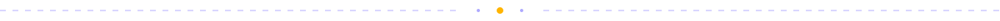
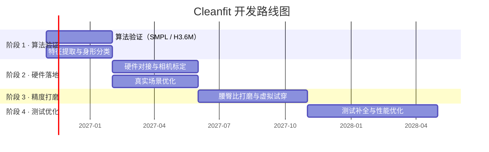

<picture>
  <source media="(prefers-color-scheme: dark)" srcset="assets/hero-dark.svg">
  <source media="(prefers-color-scheme: light)" srcset="assets/hero-light.svg">
  
</picture>

<div align="center">


<br/><br/>

<picture>
  <source media="(prefers-color-scheme: dark)" srcset="assets/pillars-dark.svg">
  <source media="(prefers-color-scheme: light)" srcset="assets/pillars-light.svg">
  
</picture>

</div>



<details open>
<summary>📑 <b>目录</b></summary>
<br/>

- [🎯 当前进度 · 聚焦测量精度](#-当前进度--聚焦测量精度)
- [项目简介](#项目简介)
- [核心功能](#核心功能)
- [实时演示 · 4D 测量工作台 + Pose Mirror](#实时演示--4d-测量工作台--pose-mirror)
- [系统架构](#系统架构)
- [硬件方案](#硬件方案)
- [精度指标](#精度指标)
- [开发路线图](#开发路线图)
- [项目结构](#项目结构)
- [快速开始](#快速开始)
- [边界说明](#边界说明)
- [参与贡献](#参与贡献)

</details>


## 🎯 当前进度 · 聚焦测量精度

> **当前主攻方向：人体测量比例的精准度。** 试衣、AI 精修、3D 全息、Decart 实时换装等原型
> **保持原样、暂不迭代**，所有新工作都围绕「把尺寸测准」展开。
> 本页上半部分的 `≤5% 误差`、深度相机点云与 18 个月路线图是**长期目标**，尚未做真人卷尺对照实验；
> 下面这一节才是仓库里**现在真的能跑**的东西。

### 现在能跑什么

| 模块 | 状态 | 入口 | 说明 |
|:---|:---:|:---|:---|
| **4D 人体尺寸测量工作台** ← 主攻 | ✅ 可运行 | [`demo/measure.html`](demo/measure.html) | 浏览器端：BlazePose 3D 关键点 + 多帧/多姿态/多视角稳健融合 + 外部尺度标定 + 卷尺锚点，输出 14 项尺寸与 CV / 置信度，导出 JSON / CSV |
| Pose Mirror 试衣原型 | 🧊 保留 | [`demo/index.html`](demo/index.html) | 摄像头取景 + 实时 3D 全息人像 + 网格贴衣，跟随灵敏度可调 |
| AI 精修（本地 GPU） | 🧊 保留 | [`tryon_server/`](tryon_server/) | SD1.5-inpainting 对贴好的躯干重绘一次再烘焙回贴图，RTX 5070 实测 1.7s |
| Decart Lucy VTON 实时换装 | 🧊 保留 | [`holo/`](holo/) | 生成式视频扩散路线（需 API key），当前未启用 |
| 点云算法层 | 🚧 骨架 | [`src/cleanfit/`](src/cleanfit/) | 仅 `segment.py` 有基线实现，其余为数据契约 |

**线上体验**：<https://cleanfit-holo.apps.workbuddy.host/?sharecode=LATEL4JUFX>
（首页右上角「精准测量 →」进入工作台；`measure.html?demo` 无摄像头也能跑通全链路）

### 精度主线：为什么这么做

BlazePose 的 `poseWorldLandmarks` 是**模型先验尺度**，会把个体拉向人群平均值；单帧还有关键点抖动、
遮挡误检、侧身透视缩短。所以精度不靠「换个更重的单帧模型」，而靠一整套测量方法：

| 手段 | 解决的问题 |
|:---|:---|
| **3D 段长 × 时间序列（4D）** | 段长与视角无关（实测转体 90° 变化 `0.000000`），多帧融合压随机噪声 |
| **ROI 限定区域（段级过滤）** | 框全身出全身数据、只框上半身只出上半身指标；摄像头装不下全身时可分两段采集自动合并 |
| **5 类姿态分桶 + 质量评分** | 正面 / 抬臂 / 斜侧 / 侧身 / 移动，逼出采样多样性 —— 重复同一姿态不增加信息 |
| **MAD 离群剔除 + 截尾加权均值** | 抗误检尖峰，输出 CV / 样本数 / 置信度 / 收敛度 |
| **外部尺度标定** | 已知身高 / A4 同平面参照物 / 激光测距，把模型先验尺度映射成真实厘米；每行可填卷尺实测锚点 |
| **多设备** | 多摄像头切换并入同一份样本；预留 `window.CleanfitDepthSource` 给 D4xx / LiDAR |

### 已验证 / 尚未验证

| 已验证 ✅ | 结果 |
|:---|:---|
| 视角不变性 | 转体 90°，3D 段长变化 `0.000000` |
| 融合抗噪（合成序列 400 帧、4mm 关节噪声 + 5% 离群帧） | 身高误差 `0.000cm`、肩宽 `0.009cm`、平均 CV `0.79%`、剔除 19 个离群帧 |
| 浏览器端到端（快速模式） | 49 帧自动收敛、置信度 100%、导出 14 项 / CSV 15 行 |
| ROI 段级过滤 | 框上半身后身高 / 大腿为 `--`，肩宽 / 上臂仍有值 |
| 摄像头 4:3 全身优先 | 640×480 默认，切 16:9 自动重协商为 1280×720 |

> ⚠️ **尚未验证**：以上数值来自**合成骨架序列与算法收敛性测试**，不是真人卷尺对照实验。
> 真实绝对精度取决于标定质量、关键点稳定性与遮挡；围度（胸 / 腰 / 臀围、臂展）是经验系数估算。
> README 中的 `≤5%` 仍是**目标**，不是已达成指标。

> 🔌 **硬件实测（2026-11）**：本机 `Intel RealSense SR300` 的 Depth 设备在 Windows 中为 `Error`，
> `pyrealsense2 2.59` 已移除 SR300 支持（`query_devices()` 返回 0 台），浏览器也读不了 Z16 / Y8 格式。
> **当前拿不到真实深度帧**，绝对尺度因此由激光测距 / 已知参照物 / 已知身高这类外部基准提供；
> 接上 D4xx / LiDAR 后实现 `window.CleanfitDepthSource.getDistanceM(u, v, t)` 即可自动并入标定。


## 项目简介

<table>
 <tr>
  <td align="left">

**Cleanfit** 是一款桌面级精准身形测量工具，以消费级深度相机为硬件载体，通过 AI 三维视觉算法精准提取人体比例与身形特征，输出标准化身形分类和版型适配建议，并附带静态虚拟试穿效果验证。

项目走 **「小而准」** 的技术路线 —— 限定场景深耕精度，不做全场景泛化，不堆砌冗余功能。

> 🚧 **项目正在积极开发中。** 当前阶段聚焦「人体测量比例精准度」，
> 可运行成果与验证数据见上方 [当前进度](#-当前进度--聚焦测量精度)。

  </td>
 </tr>
</table>

## 核心功能

<table>
 <tr>
  <td align="center" width="50%" valign="top">
    <br/>
    <h3>🔬 三维比例精准测量</h3>
    <p>深度相机采集人体点云 → AI 提取骨性特征点 → 自动校正透视与距离畸变 → 输出三大核心比例数据。</p>
    <sub><code>头身比</code> <code>肩宽/身高</code> <code>腰臀比</code></sub>
    <br/><br/>
  </td>
  <td align="center" width="50%" valign="top">
    <br/>
    <h3>📊 标准身形分类与版型适配</h3>
    <p>基于比例数据对标行业身形标准，自动分类身形，输出对应上衣 / 下装的版型推荐和雷区版型提示。</p>
    <sub><code>修身</code> <code>合身</code> <code>宽松</code></sub>
    <br/><br/>
  </td>
 </tr>
 <tr>
  <td align="center" width="50%" valign="top">
    <br/>
    <h3>👕 静态虚拟试穿验证</h3>
    <p>上传单件衣服平面图 → 基于测量的身形比例自动形变贴合 → 生成正面试穿效果图，直观验证版型适配效果。</p>
    <sub>照片级静态效果，非实时 AR</sub>
    <br/><br/>
  </td>
  <td align="center" width="50%" valign="top">
    <br/>
    <h3>📋 结构化报告导出</h3>
    <p>输出比例数据、身形分类、版型适配建议的图文报告，可保存、可分享、可对比。</p>
    <sub>PDF / 图片</sub>
    <br/><br/>
  </td>
 </tr>
</table>

## 实时演示 · 4D 测量工作台 + Pose Mirror

### ① 4D 人体尺寸测量工作台（当前主攻）

```bash
# 推荐：Windows 一键启动（起本地 GPU 精修服务 + 静态站点）
start_demo.bat

# 或只起静态站点（摄像头需要 localhost / https）
python -m http.server 8851 --directory demo
# → http://127.0.0.1:8851/measure.html        （摄像头实测）
# → http://127.0.0.1:8851/measure.html?demo   （无摄像头，合成姿态跑通全链路）
```

| 环节 | 方案 |
|:---|:---|
| 姿态估计 | MediaPipe BlazePose（lite），33 个 3D 世界关键点，关闭内置时域平滑以降低延迟 |
| 限定区域 | 画面上直接鼠标拖框；框内拖动 / 拖边缩放 / 双击删除，过滤下沉到「段」级 |
| 采样 | 灵敏度 1–10 档；5 类姿态分桶引导；快速 / 标准 / 高精度三档 + 达标自动停止 |
| 融合 | 质量评分 → MAD 离群剔除 → 10% 截尾加权均值；输出 CV、样本数、置信度、收敛度 |
| 尺度 | 已知身高 / A4 同平面参照物 / 激光测距 + 参照物 / 仅激光；卷尺锚点可逐项覆盖 |
| 输出 | 14 项尺寸（cm）+ JSON / CSV 导出，含标定方式、ROI、视角数、采集参数 |
| 入画 | 头顶 / 脚部 / 左右出画检测 + 4:3 全身优先 + 半身拼接采集引导 |
| 依赖 | 全部本地化（`demo/vendor/`），无外链、无 CDN，可离线运行 |

完整算法说明、标定公式与验证数据见 [`demo/README.md`](demo/README.md)。

### ② Pose Mirror 姿态镜像（原型，保持原样）

浏览器端可跑的姿态镜像原型：左侧取景窗口接入摄像头，右侧实时重建一具 3D 全息人像，
把画面里人的动作一比一复刻过去，并在取景画面上叠加肩线 / 腰线 / 胯线的测量标注。

同一静态服务下打开 `http://127.0.0.1:8851/` 即可（也可用 `python demo/serve.py`，默认 8848）。

| 环节 | 方案 |
|:---|:---|
| 姿态估计 | MediaPipe BlazePose，33 关键点，输出以米为单位的世界坐标 |
| 3D 重建 | Three.js 按关键点摆位，关节球 + 骨骼柱 + 躯干面片，自适应平滑去抖 |
| 测量 | 人像分割掩码逐行扫描外轮廓，肩 / 腰 / 胯取宽度极值，身高定标换算成厘米 |
| 依赖 | 全部本地化（`demo/vendor/`），无外链、无 CDN，可离线运行 |

这是**视觉与交互的原型验证**，不是最终算法：它用单目 RGB 做估计，精度达不到项目指标，
作用是先把「取景 → 追踪 → 3D 复刻 → 数据面板」这条链路的交互语言定下来。
正式的精度主线见上方 ① 与「系统架构」。

## 系统架构

<picture>
  <source media="(prefers-color-scheme: dark)" srcset="assets/arch-dark.svg">
  <source media="(prefers-color-scheme: light)" srcset="assets/arch-light.svg">
  
</picture>

<table>
 <tr>
  <th align="left" width="24%">模块</th>
  <th align="left">做什么</th>
  <th align="left" width="30%">关键点</th>
 </tr>
 <tr>
  <td><b>① 点云分割与去噪</b></td>
  <td>从衣物边缘、头发、地面噪声中分离出干净的人体轮廓</td>
  <td>边缘噪声是最大的误差来源</td>
 </tr>
 <tr>
  <td><b>② 骨性特征点定位</b></td>
  <td>自动定位头顶、肩峰、腰最细处、臀峰、脚底</td>
  <td>只认骨性标志，不认脂肪与衣物</td>
 </tr>
 <tr>
  <td><b>③ 透视与距离校正</b></td>
  <td>结合相机内参与深度信息，修正不同距离、微小俯仰造成的比例畸变</td>
  <td>1.2m 处 ±0.1m 内保持稳定</td>
 </tr>
 <tr>
  <td><b>④ 分类与版型匹配</b></td>
  <td>比例 → 身形 → 版型，每一句建议都能追溯到具体数据</td>
  <td>可解释，不做黑箱推荐</td>
 </tr>
</table>

## 硬件方案

<table>
 <tr>
  <th width="25%" align="center">📷 深度相机</th>
  <th width="25%" align="center">💰 硬件预算</th>
  <th width="25%" align="center">🎯 选型理由</th>
  <th width="25%" align="center">🔗 软硬结合</th>
 </tr>
 <tr>
  <td align="center">奥比中光 Astra Mini Pro<br/><b>开发版</b></td>
  <td align="center">¥850–950<br/><sub>含官方 SDK 与标定板的完整开发套件</sub></td>
  <td align="center">1 米距离深度均方误差 &lt; 1.5mm<br/><sub>稳定实现 ≤5% 误差的最低硬件门槛</sub></td>
  <td align="center">USB 直连电脑<br/><sub>专属镜头畸变校正、深度噪声适配、特征点优化，算法与硬件<b>深度绑定</b></sub></td>
 </tr>
</table>

> 💡 **为什么不用手机摄像头？** 单目 RGB 缺少真实深度，比例只能靠模型"猜"，误差随姿态和光照剧烈波动。深度相机直接给出几何真值，这是 ≤5% 的前提。

## 精度指标

> 🧪 **状态说明**：下表是**长期目标（受控场景下的误差承诺）**，目前**尚未通过真人卷尺对照实验验证**。
> 当前已验证的是算法收敛性与稳定性（合成序列 + 浏览器端到端），数据见
> [当前进度](#-当前进度--聚焦测量精度) 与 [`demo/README.md`](demo/README.md)。

> 📏 目标指标均基于限定测试场景：室内均匀柔光、正面自然站立、紧身打底衣物、拍摄距离 1.2m ± 0.1m

<table>
 <tr>
  <th align="center" width="18%">类型</th>
  <th align="center">指标</th>
  <th align="center" width="26%">目标误差（未验证）</th>
 </tr>
 <tr>
  <td align="center">✅ <b>保证项</b></td>
  <td>头身比、肩宽 / 身高比</td>
  <td align="center">相对误差 ≤ <b>5%</b></td>
 </tr>
 <tr>
  <td align="center">📌 <b>参考项</b></td>
  <td>腰臀比</td>
  <td align="center">相对误差 ≤ <b>7%</b></td>
 </tr>
</table>

**输出形式**：身形分类（倒三角 / H 型 / 梨型 / 苹果型）+ 比例观感描述 + 版型适配建议

<picture>
  <source media="(prefers-color-scheme: dark)" srcset="assets/shapes-dark.svg">
  <source media="(prefers-color-scheme: light)" srcset="assets/shapes-light.svg">
  
</picture>

## 开发路线图

### 当前阶段（2026-11）· 精度专项

原 18 个月路线图保留在下方的折叠区作为长期方向；**近期只做「人体测量比例精准度」这一条线**，其余模块冻结：

- [x] 浏览器端 4D 测量工作台：ROI 段级过滤 / 姿态分桶 / 稳健融合 / 尺度标定 / 导出
- [x] 采集灵敏度、快速达标停止、4:3 全身入画与入画检测、半身拼接
- [ ] **真人卷尺对照实验**：固定样本做 Bland–Altman / 相对误差统计，把「目标 ≤5%」变成有数据支撑的结论
- [ ] 接入可用的深度源（D4xx / LiDAR）替换外部尺度基准，消除模型先验比例的系统偏差
- [ ] 多摄像头外参标定，让「多视角」从「并入样本」升级为真正的三维重建
- [ ] 同一个人不同天 / 不同衣物的纵向复测与误差来源拆解

<details>
<summary>📅 <b>长期路线图（原 18 个月计划，保留）</b></summary>
<br/>



| 阶段 | 周期 | 重点 |
|:---:|:---|:---|
| **1** | 第 1–3 月 | 基于 SMPL / Human3.6M 数据集跑通算法；特征提取、比例校正、身形分类 |
| **2** | 第 4–7 月 | 硬件对接；相机标定、畸变校正、真实场景优化、基础界面 |
| **3** | 第 8–12 月 | 功能完善；腰臀比精度打磨、身形分类、虚拟试穿开发 |
| **4** | 第 13–18 月 | 测试补全、性能优化、可选拓展（侧面测量 / 多体位验证） |

</details>

## 项目结构

```
Cleanfit/
├── demo/                      浏览器端原型（详见 demo/README.md）
│   ├── measure.html           ★ 4D 人体尺寸测量工作台（当前主攻）
│   ├── index.html             Pose Mirror 试衣原型（保留）
│   ├── js/anthro.js           ★ 4D 测量引擎：ROI / 姿态分桶 / 稳健融合 / 尺度标定
│   ├── js/measure-app.js      ★ 工作台 UI：摄像头 / 鼠标框选 / 采样 / 导出
│   ├── js/rig.js              Three.js 全息人像
│   ├── js/fitting.js          网格贴衣（保留）
│   ├── js/app.js              Pose Mirror 主逻辑
│   ├── css/measure.css        ★ 工作台样式
│   └── vendor/                本地化 BlazePose / three.js（零外链，可离线）
├── tryon_server/              本地 GPU 重绘服务（SD1.5-inpaint，保留）
├── holo/                      Decart Lucy VTON 实时换装原型（需 API key，保留）
├── src/cleanfit/              Python 点云算法层（长期方向，骨架）
│   ├── segment.py             ① 点云分割与去噪（唯一有基线实现的模块）
│   ├── capture.py             采集层 · 深度帧与彩色帧对齐
│   ├── landmark.py            ② 骨性特征点定位
│   ├── calibrate.py           ③ 透视与距离校正
│   ├── classify.py            ④ 身形分类与版型匹配
│   ├── tryon.py / report.py   静态试穿 / 报告导出
│   └── pipeline.py / __main__.py  四层串联 / 命令行入口
├── docs/                      逆向报告与效果截图
├── tests/                     测试
├── assets/                    README 图形素材（本地 SVG，零外链）
├── .github/                   Issue / PR 模板 + CI
├── start_demo.bat             Windows 一键启动本地服务
├── pyproject.toml             打包与工具配置
├── requirements.txt           运行时依赖
├── CONTRIBUTING.md            贡献指南
├── LICENSE                    MIT
└── README.md
```

> 🧩 **Python 层状态**：`segment.py` 已有基线实现（深度阈值 + 形态学开闭 + 连通域，纯 numpy，含单元测试）；其余算法模块只定义了数据结构与函数签名，调用会抛 `NotImplementedError` —— 目的是先固定四层之间的数据契约。
> **当前可运行、且持续迭代的是 `demo/` 下的浏览器端 4D 测量工作台**，见上方「实时演示」。

## 快速开始

### 👉 体验当前成果：4D 人体尺寸测量工作台（推荐，无需 Python 算法依赖）

```bash
git clone https://github.com/Aholic-12/Cleanfit.git
cd Cleanfit

# 任选静态服务器；摄像头需要 localhost 或 https
python -m http.server 8851 --directory demo
# → http://127.0.0.1:8851/measure.html        实测
# → http://127.0.0.1:8851/measure.html?demo   无摄像头演示
```

Windows 也可直接双击 `start_demo.bat`（额外启动本地 GPU 精修服务）。
线上版本：<https://cleanfit-holo.apps.workbuddy.host/?sharecode=LATEL4JUFX>

> 打开后：在画面上直接拖框限定测量区域 → 填真实身高（或激光测距 / A4 参照物）→ 点「开始采样」，
> 快速档达标自动停止 → 导出 JSON / CSV。完整用法见 [`demo/README.md`](demo/README.md)。

### Python 点云算法层（长期方向）

```bash
# 进入项目目录后
pip install -e .          # 可编辑模式，同时装好依赖
# 或
pip install -r requirements.txt
```

> 📷 奥比中光 Astra SDK 不在 PyPI 上，需从官网下载安装。**不装 SDK 也能跑算法层**——只要不进 `capture` 模块，其余部分可以用离线数据开发。

<details>
<summary>📦 <b>环境依赖</b></summary>
<br/>

<table>
 <tr>
  <th align="left">依赖</th>
  <th align="left" width="18%">版本</th>
  <th align="left">用途</th>
 </tr>
 <tr><td>Python</td><td><code>3.9+</code></td><td>运行时</td></tr>
 <tr><td>Open3D</td><td><code>0.17+</code></td><td>点云处理</td></tr>
 <tr><td>奥比中光 Astra SDK</td><td><code>最新版</code></td><td>深度相机接口</td></tr>
 <tr><td>NumPy</td><td><code>最新版</code></td><td>数值计算</td></tr>
 <tr><td>OpenCV</td><td><code>最新版</code></td><td>图像处理与标定</td></tr>
</table>

</details>

<details>
<summary>⚠️ <b>运行前请确认</b></summary>
<br/>

- 相机通过 USB 3.0 直连（避免 USB Hub 降压掉帧）
- 环境为室内均匀柔光，避免顶光直射与逆光
- 穿着紧身打底衣物，赤足站立
- 拍摄距离保持 **1.2m ± 0.1m**，镜头与身体正面平行

</details>

## 边界说明

> ⚠️ 以下是有意为之的设计约束，不是缺陷。

<table>
 <tr>
  <td width="50%" valign="top">
    <br/>
    <b>🚫 不做实时 AR 试穿</b><br/>
    <sub>仅实现静态照片级试穿效果，不涉及布料仿真与动态渲染。</sub>
    <br/><br/>
  </td>
  <td width="50%" valign="top">
    <br/>
    <b>🧠 聚焦 AI 能力</b><br/>
    <sub>核心聚焦三维特征提取与校正，不为堆砌 AI 而滥用模型。</sub>
    <br/><br/>
  </td>
 </tr>
 <tr>
  <td width="50%" valign="top">
    <br/>
    <b>🎯 限定场景精度</b><br/>
    <sub>所有指标均基于受控测试环境，不夸大全场景通用效果。</sub>
    <br/><br/>
  </td>
  <td width="50%" valign="top">
    <br/>
    <b>⚡ 精度优先</b><br/>
    <sub>优先保证核心测量的精度与稳定性，再考虑功能拓展。</sub>
    <br/><br/>
  </td>
 </tr>
 <tr>
  <td width="50%" valign="top">
    <br/>
    <b>🔌 深度源待接入</b><br/>
    <sub>实测 SR300 深度流不可用（驱动 Error + librealsense 已弃用该型号）。当前用激光测距 / 参照物 / 已知身高做外部尺度基准，不假装已有深度真值。</sub>
    <br/><br/>
  </td>
  <td width="50%" valign="top">
    <br/>
    <b>📐 估算项不冒充实测</b><br/>
    <sub>胸 / 腰 / 臀围与臂展是宽度乘经验系数的推算；14 项里只有 3D 骨骼段长属于直接测得，导出文件逐项标注类型。</sub>
    <br/><br/>
  </td>
 </tr>
</table>

## 参与贡献

欢迎贡献代码！如果你有想法或想一起打造 Cleanfit，完整流程见 **[CONTRIBUTING.md](CONTRIBUTING.md)**。

```
Fork → Branch → Commit → Push → PR
```

1. Fork 本仓库
2. 创建你的功能分支 (`git checkout -b feature/amazing-feature`)
3. 提交你的修改 (`git commit -m 'feat(landmark): 用切片宽度曲线定位肩峰'`)
4. 推送到分支 (`git push origin feature/amazing-feature`)
5. 发起 Pull Request

> 提 PR 前请先跑 `ruff check .` 和 `pytest`。涉及精度改动的，附上改动前后的误差对比数据。


<br/>

<picture>
  <source media="(prefers-color-scheme: dark)" srcset="assets/footer-dark.svg">
  <source media="(prefers-color-scheme: light)" srcset="assets/footer-light.svg">
  
</picture>

<div align="center">

<br/>

<a href="https://github.com/Aholic-12">
  
</a>

<br/><br/>

<i>⭐ 如果你喜欢这个项目，请给个 Star 支持一下！</i>

<br/><br/>

<sub>本 README 的全部图形均为仓库内本地 SVG（含 SMIL 动效），不依赖任何外部图床。</sub>

</div>
